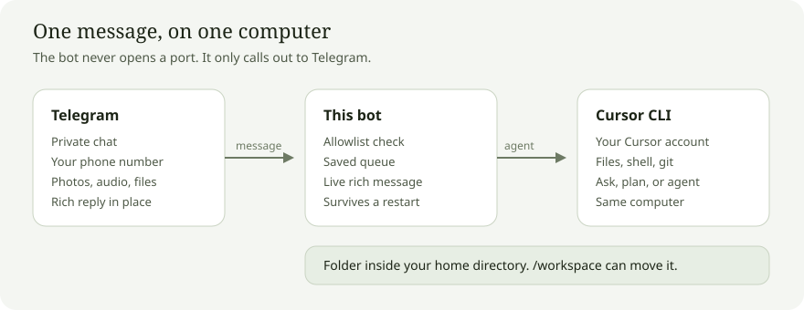

# Cursor Telegram

A private Telegram bot that drives the [Cursor CLI](https://cursor.com/docs/cli/overview) on the same computer. You message the bot. The CLI edits files, runs commands, and answers in that chat. The bot only makes outbound calls to Telegram, so the computer does not open a port.

A message that starts with `&` is rejected. The chat cannot be handed to a Cursor cloud agent.

The default folder is your home directory. `/workspace` can move it anywhere inside your home directory.



## Dependencies

| | |
|---|---|
| Cursor subscription | The CLI runs with your Cursor account and uses that subscription. |
| Cursor CLI | The `agent` command. Tool calls happen on this computer. |
| Telegram bot | A token from [@BotFather](https://t.me/BotFather), and the phone numbers allowed to use it. |
| uv | Installs the Python version and runs the bot. The bot itself uses the Python standard library only. |
| Linux systemd | Optional. `scripts/install.sh` keeps the bot running as a user service. You can also run it in the foreground. |

Python 3.11 or newer is required. uv selects it.

## Setup

1. Install [uv](https://docs.astral.sh/uv/getting-started/installation/).

2. Install the Cursor CLI and sign in:

```bash
curl -fsSL https://cursor.com/install | bash
./scripts/login.sh
```

`login.sh` prints a URL. Open it and approve this computer. Leave the command running until it finishes.

3. Clone this repo and sync the Python project:

```bash
uv sync
```

4. In Telegram, open @BotFather, send `/newbot`, and copy the token.

5. Copy the example env file and fill it in:

```bash
cp .env.example .env
```

```bash
TELEGRAM_BOT_TOKEN=123456:replace-me
TELEGRAM_ALLOWED_PHONES=+15551234567
```

Use full international numbers, comma-separated. `CURSOR_WORKSPACE` is optional. When it is set, it must be a folder inside your home directory.

6. Install and start the service:

```bash
./scripts/install.sh
```

This writes `~/.config/cursor-telegram/env` with mode `600`, installs a systemd user service, and starts it. The token and phone list are not committed.

7. Open the bot, tap **Share my phone number**, then send a task.

The bot answers in a private chat only. Telegram attaches the shared contact to the sender's account. A typed number or someone else's contact is ignored. When the number is on the list, that Telegram user stays allowed until the number is removed and the service is restarted. Anyone else gets a refusal and no Cursor session.

The bot runs as the user who starts it. In `agent` mode the agent has that user's full power on purpose: Claude Code runs with `bypassPermissions` and Cursor with `--force` and no sandbox. The chosen folder is only where it starts, not a boundary, and on a host with passwordless sudo that includes root. The bot's own guardrails are narrower: only allowlisted phones can reach it, `/files` never offers keys, `.ssh`, `.config` or the bot's state, and the Telegram token and phone list are removed from the agent's environment. Use `/mode ask` or `/mode plan` when you want it to stop editing.

## Setup page

The bot serves a small page on `127.0.0.1:8787` of the machine it runs on. It switches between Cursor and Claude Code, sets the model, Claude effort and mode, and signs each tool in: the Sign in button starts the vendor's own login, shows the link it prints, and has a box for a code if the login asks for one. Passwords are never typed into the page.

```bash
./scripts/ui.sh
```

This prints the address with its key and the SSH tunnel command for opening it from another computer. The key lives in `~/.config/cursor-telegram/ui-key`. The page refuses other host names, needs the key on every request, and never listens on the network. Set `CURSOR_TELEGRAM_UI=off` to disable it or `CURSOR_TELEGRAM_UI_PORT` to move it. Changes apply to the next message; model, effort and mode are written to every existing chat.

## Run in the foreground

```bash
set -a && source ~/.config/cursor-telegram/env && set +a
uv run python bot.py
```

Run `scripts/install.sh` once so that env file exists, or export the same variables yourself.

## Commands

`/status` shows the account, folder, and chat. `/new` starts a fresh chat. `/cancel` stops the current run. A message sent while Cursor is busy waits its turn. That queue is saved, so a restart keeps the waiting messages and continues them in the same Telegram message.

`/cli cursor` and `/cli claude` choose which local tool runs the next message. Each tool keeps its own session. A run already in progress finishes on the tool it started with. `/mode agent` edits files and runs commands. `/mode ask` is read-only. `/mode plan` plans only. `/model` shows or sets the Cursor model for the next message. `/model auto` uses the CLI default. `/workspace` shows or sets the folder.

`/clear` deletes chat messages in Telegram and keeps the Cursor session. `/files` lists files in the folder, including photos and audio.

Changing the allowlist means updating `.env` and running `scripts/install.sh` again.

## Tests

```bash
uv run python -m unittest discover -s tests -t .
```

## Stop

```bash
./scripts/teardown.sh
./scripts/teardown.sh --purge
```

`--purge` removes the service, the token, the allowlist, and the bot state. It leaves the Cursor CLI and its login in place.
