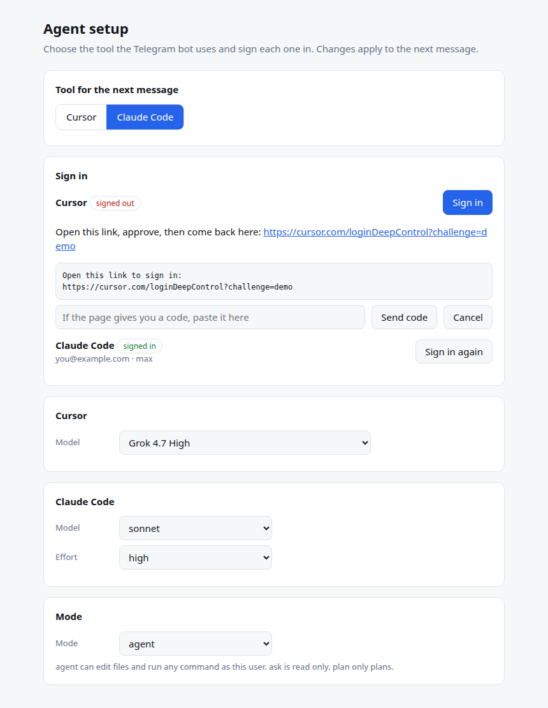

# Telegram Agent

A private Telegram bot that runs a coding agent on your own computer. You message the bot. [Cursor](https://cursor.com/docs/cli/overview) or [Claude Code](https://docs.claude.com/en/docs/claude-code/overview) edits files, runs commands, and answers in that same chat. The bot only makes outbound calls to Telegram, so the computer does not open a port.


## What you get

- **Two agents, one chat.** `/cli cursor` or `/cli claude` picks the tool for the next message. Each tool keeps its own session, so switching never loses the other conversation.
- **A live reply.** One Telegram message is edited as the work happens: what the agent is doing, the tools it ran, then the answer.
- **Pick models with buttons.** `/model` shows tappable buttons for the active tool. `/effort` sets how hard Claude Code thinks.
- **A setup page** for switching tools, choosing models, and signing each one in, without typing commands.
- **Files in both directions.** Send a photo or voice note and the agent can read it. Files the agent makes come back in the chat. `/files` lists the folder.
- **A queue that survives restarts.** A message sent while the agent is busy waits its turn and continues after a restart.
- **Locked to you.** Only allowlisted phone numbers get through, in private chat only.



The default folder is your home directory. `/workspace` can move it anywhere inside your home directory. A message that starts with `&` is rejected, so a chat cannot be handed to a Cursor cloud agent.

## Dependencies

| | |
|---|---|
| Cursor CLI | The `agent` command, signed in to a Cursor account. Required, since Cursor is the default. |
| Claude Code | The `claude` command at `~/.local/bin/claude`, signed in. Optional. Needed only for `/cli claude`. |
| Telegram bot | A token from [@BotFather](https://t.me/BotFather), and the phone numbers allowed to use it. |
| uv | Installs the Python version and runs the bot. The bot itself uses the Python standard library only. |
| Linux systemd | Optional. `scripts/install.sh` keeps the bot running as a user service. You can also run it in the foreground. |

Python 3.11 or newer is required. uv selects it.

## Setup

1. Install [uv](https://docs.astral.sh/uv/getting-started/installation/).

2. Install the Cursor CLI and sign in:

```bash
curl -fsSL https://cursor.com/install | bash
./scripts/login.sh
```

`login.sh` prints a URL. Open it and approve this computer. Leave the command running until it finishes. To use Claude Code too, install it and run `claude auth login`, or sign in later from the setup page.

3. Clone this repo and sync the Python project:

```bash
uv sync
```

4. In Telegram, open @BotFather, send `/newbot`, and copy the token.

5. Copy the example env file and fill it in:

```bash
cp .env.example .env
```

```bash
TELEGRAM_BOT_TOKEN=123456:replace-me
TELEGRAM_ALLOWED_PHONES=+15551234567
```

Use full international numbers, comma-separated. `CURSOR_WORKSPACE` is optional. When it is set, it must be a folder inside your home directory. `CURSOR_MODEL` and `CLAUDE_MODEL` set the starting model for each tool.

6. Install and start the service:

```bash
./scripts/install.sh
```

This writes `~/.config/cursor-telegram/env` with mode `600`, installs a systemd user service, and starts it. The token and phone list are not committed.

7. Open the bot, tap **Share my phone number**, then send a task.

## Setup page



The bot serves a small page on `127.0.0.1:8787` of the machine it runs on. It switches between Cursor and Claude Code, sets the model, Claude effort and mode, and signs each tool in. The Sign in button starts the vendor's own login, shows the link it prints, and has a box for a code if the login asks for one. Passwords are never typed into the page.

```bash
./scripts/ui.sh
```

This prints the address with its key and the SSH tunnel command for opening it from another computer. The key lives in `~/.config/cursor-telegram/ui-key`. The page refuses other host names, needs the key on every request, and never listens on the network. Set `CURSOR_TELEGRAM_UI=off` to disable it or `CURSOR_TELEGRAM_UI_PORT` to move it. Changes apply to the next message. Model, effort and mode are written to every existing chat.

## Commands

| | |
|---|---|
| `/status` | Account, folder, tool, model, effort, and chat. |
| `/cli cursor`, `/cli claude` | Choose the tool for the next message. A run already in progress finishes on the tool it started with. |
| `/model` | Buttons for the active tool. `/model name` sets one directly. `/model auto` (Cursor) or `/model default` (Claude) uses the tool's default. |
| `/effort` | Claude Code effort: low, medium, high, xhigh, max, or default. |
| `/mode agent`, `ask`, `plan` | Edit and run, read-only, or plan only. |
| `/workspace` | Show or set the folder. |
| `/new` | Start a fresh chat for the active tool. |
| `/cancel` | Stop the current run. Queued messages still run. |
| `/clear` | Delete the chat messages in Telegram. The session stays. |
| `/files` | Newest files in the folder, including photos and audio. Tap one to get it. |

Changing the allowlist means updating `.env` and running `scripts/install.sh` again.

## Security

The bot answers in a private chat only. Telegram attaches the shared contact to the sender's account. A typed number or someone else's contact is ignored. When the number is on the list, that Telegram user stays allowed until the number is removed and the service is restarted. Anyone else gets a refusal and no agent session.

The bot runs as the user who starts it. In `agent` mode the agent has that user's full power on purpose: Claude Code runs with `bypassPermissions` and Cursor with `--force` and no sandbox. The chosen folder is only where it starts, not a boundary, and on a host with passwordless sudo that includes root.

The bot's own guardrails are narrower:

- Only allowlisted phones can reach it.
- `/files` never offers keys, `.ssh`, `.config`, or the bot's state.
- The Telegram token and phone list are removed from the agent's environment.
- The setup page listens on `127.0.0.1` only and needs its key.

Use `/mode ask` or `/mode plan` when you want the agent to stop editing.

## Run in the foreground

```bash
set -a && source ~/.config/cursor-telegram/env && set +a
uv run python bot.py
```

Run `scripts/install.sh` once so that env file exists, or export the same variables yourself.

## Tests

```bash
uv run python -m unittest discover -s tests -t .
```

## Stop

```bash
./scripts/teardown.sh
./scripts/teardown.sh --purge
```

`--purge` removes the service, the token, the allowlist, and the bot state. It leaves the Cursor and Claude Code CLIs and their logins in place.
